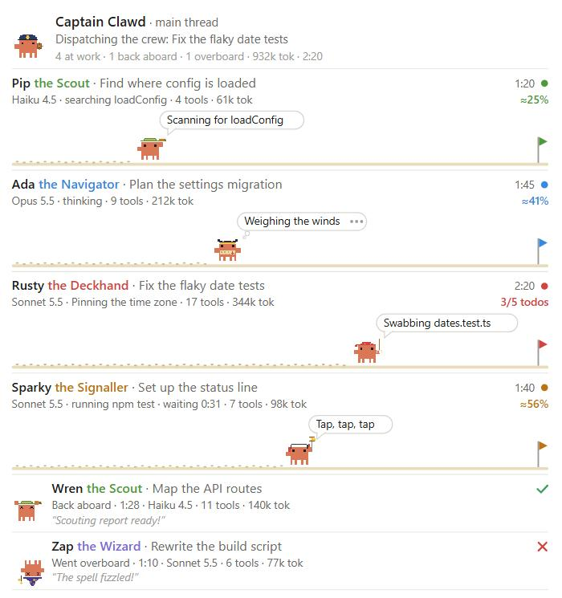
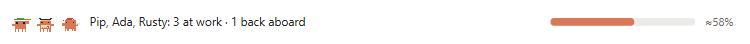
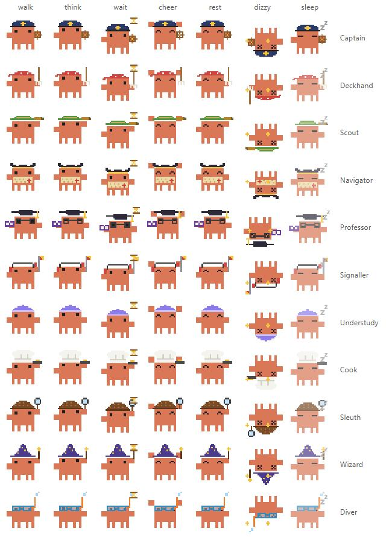

# Crab Crew

A Claude Code mod that turns your subagents into a crew of pixel crabs. Every agent type is played by its own character, with a role, a costume, a few lines of its own and a name. Each crab is animated by what its agent is doing and how far along it is.

It works with the **standard agents** (`general-purpose`, `Explore`, `Plan` and the rest) and with any custom agent type. No skills, prompts or tool calls are needed from the model: the mod watches the agents itself.



## What it does

- **The crew panel** (`/crew` toggles it). At the top is *Captain Clawd*, the main thread: at the helm while Claude works, asleep when it waits for you. Under the captain is one row per subagent:
  - who it is (*Pip the Scout*), its task, model, current action, tool calls, tokens and time;
  - a speech bubble in character (*"Land ho? Hunting config.ts"*), or a thought bubble while it thinks;
  - a beach lane on which the crab walks toward its flag as the work progresses, leaving footprints behind it.
- **The band above the prompt**: the crabs at work, a one-line summary, overall progress, a button that opens the panel, and ✕ to dismiss. It clears itself at your next prompt once everyone is back.
- **The roster**: *Meet the crew* in the panel, which is also shown while nobody is out.



### The crew

| Agent type | Character | Names | Trait | Prop |
| --- | --- | --- | --- | --- |
| `general-purpose` | Deckhand | Barnacle, Rusty, Sal… | Can-do all-rounder | mop |
| `Explore` | Scout | Pip, Wren, Kit… | Curious and quick; looks, never touches | spyglass |
| `Plan` | Navigator | Ada, Vela, Orion… | Measures twice, plots the course | chart |
| `claude-code-guide` | Professor | Kelp, Sage, Quill… | Has read every manual twice | book, mortarboard |
| `statusline-setup` | Signaller | Sparky, Dot, Morse | Tinkers with the lights and signals | semaphore flag |
| `fork` | Understudy | Echo, Mirror, Twin | Knows everything the Captain knows | — |
| any other type | Cook, Sleuth, Wizard or Diver | | dealt by the type's name, so the same type always gets the same character | pan, magnifier, wand, snorkel |

A second crab of the same character takes the next name; after the last name the list starts again with *II* (*Pip II*).

### How the crabs move



| Pose | When | Motion |
| --- | --- | --- |
| walk | working, last tool call a few seconds ago | legs step, body bobs, the prop moves (mop swishes, spyglass sweeps, flag waves…) |
| scurry | a tool call in the last 3 seconds | the same, at double pace |
| think | waiting on the model | eyes up, body sways, thought bubble with blinking dots |
| wait | a tool call running for more than 20 seconds | taps a foot under a flipping hourglass |
| cheer | just finished (6 seconds) | jumps with both claws up |
| rest | finished | happy eyes, sits still |
| dizzy | ended on an error or refusal | upside down, legs wiggling, stars |
| sleep | stopped by you | eyes closed, dimmed, *z z* rising |

All motion is CSS and stops when the system asks for reduced motion. The terminal draws the classic ASCII crab `(\/)(°,,°)(\/)` on a text lane, with frames switched once a second.

### Progress

Standard agents don't report their progress, so the lane uses the best signal available:

- **Real progress** when the agent keeps a todo list (`TodoWrite`, or `TaskCreate` / `TaskUpdate`): completed items out of all items, with half credit for the one in progress. Shown as `3/5 todos`.
- **An estimate** otherwise: it rises with the agent's tool calls toward 92% at a pace typical of its character (scouts are quick, deckhands take longer). Shown as `≈45%`. The crab reaches the flag only when the agent actually finishes.

Tokens are summed from each model request's usage. The mod shows no cost: it has no reliable price table to base one on.

## Install

At the prompt of a Claude Code terminal session:

```
/plugin install crab-crew --marketplace marwansaab/Claude-Mods
```

Answer `y` to add the marketplace and choose a scope. Then type `/crew`, or just let Claude dispatch an agent.

## Commands

| Command | Does |
| --- | --- |
| `/crew` | Shows or hides the crew panel. |

## Settings

Set them in `/config`, or for a mod loaded with `--plugin-dir`, in `~/.claude/settings.json`:

```json
{ "pluginConfigs": { "crab-crew": { "options": { "autoOpen": false, "showQuips": true } } } }
```

| Setting | Default | Effect |
| --- | --- | --- |
| `autoOpen` | `true` | Opens the panel the first time a subagent starts in a session. In a narrow terminal (under 144 columns) a pane that opens by itself waits until there is room; `/crew` always opens it. |
| `showQuips` | `true` | Speech bubbles and lines in character. Off, the rows keep only the plain facts. |

## How it works

The mod hooks the engine's own events, so the model does nothing special:

| Event | Used for |
| --- | --- |
| `agent.spawn` | casts the new subagent: its character from the agent type, and the next free name |
| `turn.step` | marks the crab as thinking; adds the request's tokens |
| `tool.call` | the crab's activity and target (`reading config.ts`), tool count, errors, todo progress; the captain's activity on the main thread |
| `turn.complete` | how the run ended: back aboard, overboard or called back |
| `prompt.submit` | clears the band once nobody is out |
| `ui.render` (`Pane`, `AbovePrompt`) | draws the panel and the band: SVG on the desktop, text on the terminal |

Every hook only observes, and is written so that a failure inside the mod can never fail a tool call, a spawn or a turn.

## Known limits

- The estimate is an estimate: an agent that makes many quick calls reaches the flag area early and waits there until it finishes.
- The function-hook API is early access; the mod was built against Claude Code 2.1.293.

## Credits

Inspired by [savvy-progress](https://github.com/JohnnyVizz/claude-kit/tree/main/plugins/savvy-progress) by johnnyvizz (MIT), whose panel and pixel crabs showed the way. Crab Crew is a separate implementation that needs no skill or reporting tool.

## Licence

MIT, see the repository's [LICENSE](../../LICENSE).
