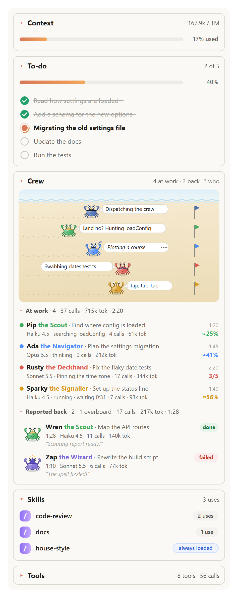
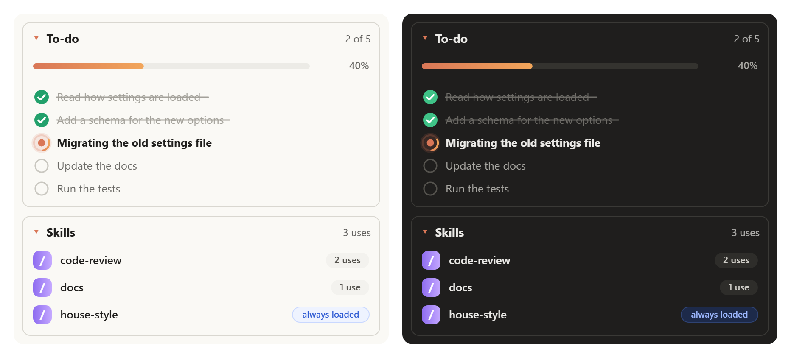
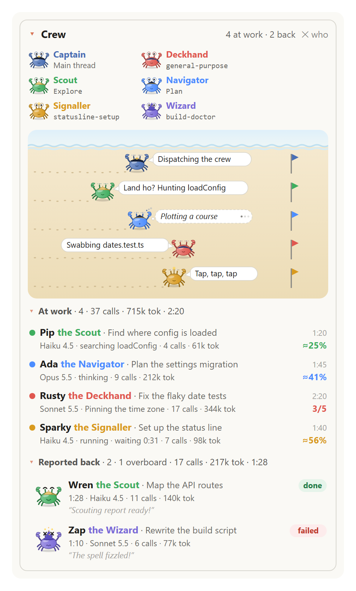
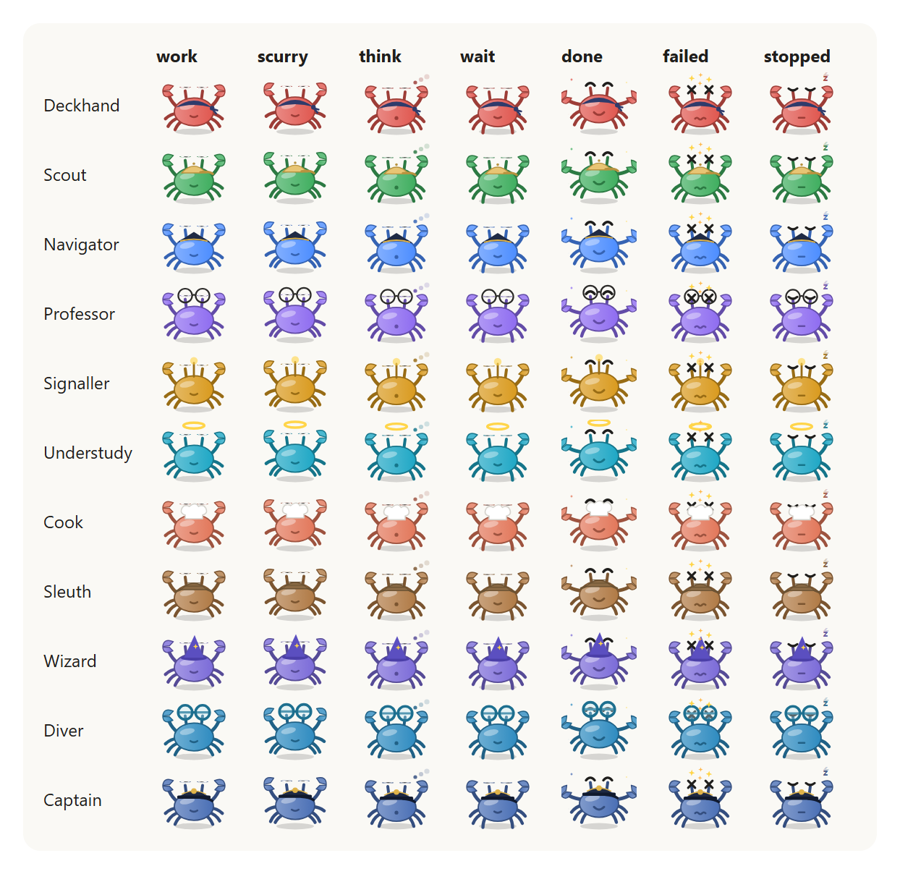
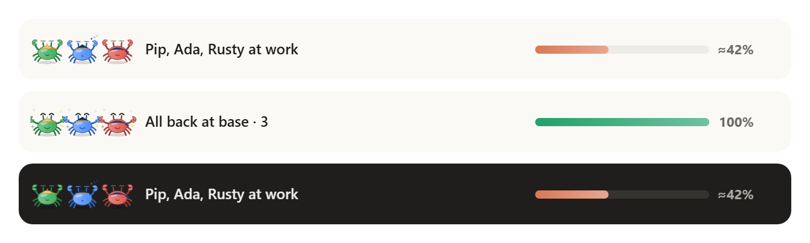
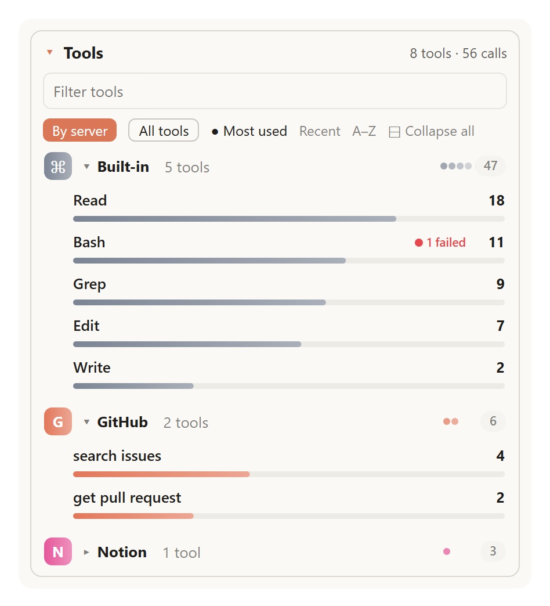

# session-lens

A pane that shows what this session is doing and has used: how full the context window is, Claude's to-do list, its crew of subagents as animated crabs racing on a beach, and the skills and tools it used. A crew band above the prompt follows the subagents while they work. Open it with `/lens`; in the desktop app it opens by itself the first time a session uses a tool or a skill.

It works with the standard agents and tools and with any MCP server or connector: no skills, prompts or tool calls are needed from the model, as the mod watches the session itself.



## What it does

The pane has five sections, each folding on its own with its arrow or title:

- **Context**: how full the context window is.
- **To-do**: Claude's current task list, with how far along it is.
- **Crew**: Captain Clawd (the main thread) and a crab for each subagent, racing toward their flags on a beach, with a row each for the crabs at work and those that reported back.
- **Skills**: each skill used, with its count.
- **Tools**: each tool used, grouped by MCP server or connector, with its count.

The counts are for this session only: only tools and skills that were actually used appear. Calls made by subagents count too. The to-do list follows the main conversation only. Your layout (which sections and groups are open, grouped or flat, the sort) is kept for your next session.

In the desktop app the rows are animated drawings, in light and dark. Each animation plays once, when its row changes, and the rest of the pane stays still. The terminal draws the same sections in text.

### Context

How full the context window is, as the status line reads it: the tokens the last response was answered over, out of the model's window, by the title (`167.9k / 1M`), and under it a bar like the to-do list's with the share used (`17% used`). It is read again each time the main conversation's model answers, so it follows compaction and `/clear`, and the bar grows from the last reading. Until the first answer it shows only its title.

### To-do and Skills



- **To-do** lists Claude's steps: ✓ done (struck through), ● in progress (bold, in its "doing now" wording, with a pulse and a sheen across it) and ○ pending. The header counts them ("2 of 5") and a bar shows how far along the list is. A step ticked off draws its check and strike-through. It follows `TodoWrite`, `TaskCreate` / `TaskUpdate` and the desktop app's own task list.
- While the lens is open in front with **To-do** unfolded, the `TodoWrite`, `TaskCreate` and `TaskUpdate` rows in the transcript are hidden, as the pane shows the same list beside it. Fold To-do, close the pane or switch to another tab, and they come back. A row that failed stays, and the ctrl+o transcript shows them all. Turn this off with the `hidePlanRows` setting.
- **Skills** lists each skill used as `/name` with a use count. Skills a memory file pulls in at start (a CLAUDE.md import) are tagged **always loaded**. A skill used for the first time flies into the list from the bottom.

### Crew



- **The beach.** Captain Clawd always has the top lane. He walks toward his flag as Claude's own to-do list moves, says what the main conversation is doing ("Dispatching the crew", "Taking the wheel: register.tsx"), and sleeps while Claude waits for you. Each subagent is a crab with a lane of its own, walking toward its flag as its progress climbs, footprints behind it, with its line in a speech bubble in character (a dashed thought bubble while it thinks). The crabs keep the order they set out in: the race is in how far each has walked.
- **At work.** A row per crab: its name, role and task, and how long it has been out; under them its model, what it is doing (and how long it has waited, when a call runs long), its calls and tokens, and its progress. For example `Haiku 4.5 · searching loadConfig · 4 calls · 61k tok`, then `≈25%`.
- **Reported back.** A crab that reaches 100% walks past its flag and stands there cheering for 3 seconds, then flies to the top of this list. A crab that fails or is stopped reports back straight away. Each row shows how the run ended (done, failed or stopped), how long it took, its model, calls and tokens, and its last line, the latest first.
- **Totals.** Beside each list's title are the race's totals for that list, a `·` between each: how many, how many went overboard or were called back, their calls and tokens, and the time. `At work · 4 · 37 calls · 715k tok · 2:20`.
- **Races.** A race starts when a crab sets out with no one at work. The lists show that race's crabs, so **Reported back** starts empty with each one. **At work** and **Reported back** fold on their own, and the beach stays.
- **Who's who.** **? who** beside the summary opens a strip of the characters on duty, the captain first, with the agent types each stands for.
- **Quiet crabs.** With the `showQuips` setting off, the crabs say nothing: no bubbles on the beach, and no last line under the crabs that reported back (their rows are shorter). The rows' details, the walk and the poses stay.

Progress comes from the agent's own to-do list when it keeps one (`3/5`), else an estimate that rises with its calls toward 92% at its character's pace (`≈45%`): only a finished crab reaches the flag. Tokens are summed over each of the agent's model requests (input, output and cache reads and writes), as crab-crew counted them.

#### The cast

| Agent type | Character | Names | Mark |
| --- | --- | --- | --- |
| main thread | Captain | Clawd | captain's hat |
| `general-purpose`, `claude` | Deckhand | Barnacle, Rusty, Sal, Dory, Mack | bandana |
| `Explore` | Scout | Pip, Wren, Kit, Marlo, Juno | cap |
| `Plan` | Navigator | Ada, Vela, Orion, Mags | tricorn |
| `claude-code-guide` | Professor | Kelp, Sage, Quill, Tomes | glasses |
| `statusline-setup` | Signaller | Sparky, Dot, Morse | antenna |
| `fork` | Understudy | Echo, Mirror, Twin | halo |
| any other type | Cook, Sleuth, Wizard or Diver | dealt by the type's name, so the same type always gets the same one | toque, deerstalker, wizard's hat, goggles |

A second crab of the same character takes the next name; after the last one the names start again with *II* (*Pip II*).

#### How the crabs move



| Pose | When | Motion |
| --- | --- | --- |
| work | at work, its last call a few seconds ago | legs step, claws snip, body bobs, eyes blink |
| scurry | a call in the last 3 seconds | the same, at twice the pace |
| think | waiting on the model | still, with a dashed thought bubble and blinking dots |
| wait | no call for 20 seconds | taps a foot; its row says how long it has waited |
| done | finished | walks past its flag, hops with claws up in a burst of sparkles, then rests |
| failed | ended on an error | sees stars, eyes crossed |
| stopped | stopped by you | eyes closed, *z z* rising |

Waves roll along the top of the beach. A crab's walk is pinned to when its progress moved, so a redraw never replays it. All motion is CSS and stops under `prefers-reduced-motion`, and the sparkles and sheens are not drawn then. The terminal draws the ASCII crab `(\/)(°,,°)(\/)` for the captain and a progress bar per crab.

#### The band above the prompt



While a crew is out, a **crew band** sits just above the prompt: its crabs, who is at work, and one bar of the crew's progress, so you can follow it without opening the pane. **Crew ×n** opens the lens at its crew, and **✕** hides the band until the next crew sets out. A new prompt sent with everyone back clears it. Other mods' rows in that band stay, under the crew's. Turn it off with the `crewBand` setting.

### Tools



- Each tool used, with a use count and a bar. Tools are grouped by their MCP server or connector, each with its own colour and tile, and the built-in tools have a group of their own. A claude.ai connector shows the name `/mcp` lists it by, not its id.
- **By server** and **All tools** switch between grouped and flat; in the flat list each tool shows its server beside its name.
- Sort by **Most used**, **Recent** or **A–Z**, and type in the filter to narrow the list. While the filter holds text, every group with a match is shown open, and **✕ Clear** empties it.
- Press a server's name to open or close its group. **⊞ Expand all** / **⊟ Collapse all** turns every group at once, and servers that show up later start the way you last chose.
- Calls that failed are counted and marked in red. A tool used for the first time flies into its list from the bottom; one that changes place, because its count passed another's or you changed the sort, flies to its new spot past the others, lit as it lands. Bars grow and a count bumps when it goes up.

### Using the pane

The first time, **Context**, **To-do**, **Crew** and **Skills** are open and **Tools** is closed, showing only its summary ("8 tools · 56 calls"). Open it to see the tools grouped by server, sorted by **Most used**, with every server collapsed. A section with nothing in it yet shows only its header.

- Press a section's arrow or title (**▾ Context**, **▾ To-do**, **▾ Crew**, **▾ Skills**, **▸ Tools**) to close or open that section; in **Crew**, **▾ At work** and **▾ Reported back** fold the same way.
- What you change is kept for your next session: open and closed sections, lists and groups, grouped or flat, the sort, and whether who's who is open. The filter always starts empty.

## Install

At the prompt of a Claude Code terminal session:

```
/plugin install session-lens --marketplace marwansaab/Claude-Mods
```

Answer `y` to add the marketplace, then choose a scope.

**session-lens replaces [crab-crew](../crab-crew).** It has its own crew of crabs and its own crew band above the prompt, so with both installed you get two crews and two bands. Don't install crab-crew alongside it, and if you already have it, disable it:

```
claude plugin disable crab-crew@claude-mods
```

Then run `/reload-plugins` in any session that is already open: a disabled plugin keeps running there until the plugins are reloaded or a new session starts. Inside a session, `/plugin` does the same from its Installed tab and reloads when you close it.

## Commands

| Command | Does |
| --- | --- |
| `/lens` | Opens the pane, or closes it when it is open |

In the desktop app the pane also opens by itself the first time a session uses a tool or a skill, unless you closed it in your last session (see Settings).

## Settings

Set them in `/config`, or for a mod loaded with `--plugin-dir`, in `~/.claude/settings.json`:

```json
{ "pluginConfigs": { "session-lens": { "options": { "autoOpen": true, "crewBand": true, "showQuips": true, "hidePlanRows": true } } } }
```

| Setting | Default | Effect |
| --- | --- | --- |
| `crewBand` | `true` | Show the crew band above the prompt while subagents are out. |
| `showQuips` | `true` | Show the crabs' speech bubbles on the beach and their last lines in the crew lists. Off, the captain's line in the terminal says only whether he is at the helm. |
| `hidePlanRows` | `true` | Hide the main conversation's `TodoWrite`, `TaskCreate` and `TaskUpdate` rows in the transcript while the pane is open in front with To-do unfolded. |
| `autoOpen` | `true` | In the desktop app, open the pane the first time a session uses a tool or a skill, unless you closed it (with its close mark or `/lens`) in your last session. In a terminal, the pane opens only with `/lens`. |

## How it works

- The context meter reads `$.session.usage()`, the status line's figures, with no breakdown, so the call is free. It is read when the session starts, after each model request of the main conversation (`turn.step`), when `/lens` opens the pane, and after `/clear`.
- A `tool.call` hook lets each call run, then counts it unless it was denied. It never changes the call, and a failure inside it is swallowed.
- The to-do list is rebuilt from the plan tools the main conversation calls: `TodoWrite`, `TaskCreate` and `TaskUpdate`, and the desktop app's own task list (`update_plan`, with `advance`, `done` and `start`). The desktop app's closing `wrap_up` call ticks every step off.
- The crew comes from the subagents' own events. `agent.spawn` casts a crab by agent type: `general-purpose` is a Deckhand, `Explore` a Scout, `Plan` a Navigator, `claude-code-guide` a Professor, `statusline-setup` a Signaller and `fork` an Understudy. Any other type is always dealt the same one of the Cook, Sleuth, Wizard and Diver. `agent.spawn` also notes the subagent's model. A subagent's `turn.step` sets its crab thinking, and once the request is answered adds its tokens (input, output and cache reads and writes, as crab-crew counts them) to the crab and updates its model; a run whose requests were not seen one by one takes its totals from `turn.complete`. Its `tool.call`s say what it is doing and feed its to-do progress, and its `turn.complete` says how the run ended. A crab that is done stays on the beach for 3 s, and a timer then notes the crew's new order so it flies to the list. The main conversation's own `turn.step`, `tool.call` and `turn.complete` do the same for the captain. While a crab works, the pane is redrawn every 5 s so a crab left without a call is drawn waiting. The band above the prompt is a `ui.render` hook on `AbovePrompt`: it shows the crabs that set out or came back since the last prompt sent with no one out, and draws what Claude Code and other mods put in the band under its own, as the band is shared; it leaves the band to them when there are none, or when a survey is up. The cast, its lines and the progress estimate are adapted from this repository's [crab-crew](../crab-crew) mod. A crab's walk along its lane is pinned to when its progress moved, as every animation here is.
- `ui.render` hooks on `ToolUse` and `ToolResult` draw nothing for a plan call's row while the pane is shown (`$.ui.panes()`) and To-do is unfolded. They hide only the calls the main conversation made, noted by id in `tool.call` and from a resumed session's transcript, and pass every other row, an errored one and the expanded ctrl+o view to the engine. Opening or closing the pane asks for a redraw so the rows follow.
- A `skill.prompt` hook counts each skill as it is expanded for the model, whether typed as `/name`, called through the Skill tool, or preloaded.
- Group names come from the session's context breakdown (`$.session.usage({ breakdown: 'summary' })`). It gives the name `/mcp` lists for each server, so a claude.ai connector shows its name rather than its id. The same breakdown names the skills loaded through memory files. It is read when the session starts, when `/lens` opens the pane, and when a tool from a new server is first called.
- A resumed session's earlier calls are counted once, from its transcript. A `/clear` starts the counts over and keeps the pane's layout.
- Counts and the layout live in `$.state`, so a reload of the mod keeps them. The layout is also written to the mod's `$.store` on each change and read back when a session starts. So is whether you closed the pane last. A `ui.close` hook notes a close you make with the pane's close mark.
- After each change that can reorder a list (a call, a skill, a new sort), the mod notes every list whose order changed: its old order, its new one, and when. Each list (the skills, each server's tools, the flat list) is drawn as one picture, so a row can fly from its old slot to its new one. Lists are compared unfiltered, and nothing flies while the filter holds text.
- The desktop drawings are SVG with CSS animations. The pane is redrawn on every event of the session, and a redrawn picture would start its animations over. So each animation is pinned to the moment its row changed: a drawing made later shows it part-way through, or with no animation once it is over. The loops on the step in progress keep their phase from one drawing to the next. The app also keeps the pane's last drawing and may show it again (a new message, a re-layout) without asking the mod, which would replay an animation caught mid-way. So about 1.6 s after each change, once its animations are over, the mod asks for one more drawing, with nothing left to replay. Under `prefers-reduced-motion` every drawing shows its final state with no motion, and the sheens and sparkles are not drawn. Each has an `alt` text, and colours follow the light or dark theme.

## Known limits

- The crew starts empty in a resumed session: crabs come only from subagents that set out in it. It keeps the 40 latest crabs.
- Tool bars use a log scale that fills at 50 calls, so a row's bar depends on its own count alone. Compare the numbers rather than the bar lengths.
- A connector whose server name the context breakdown does not list shows as `Connector` plus the first characters of its id.
- A skill typed as `/name` in a resumed session's earlier turns is not counted; skills called through the Skill tool are.
- The mobile app draws no text field, so it has no filter there.
- The desktop app's own task list, pinned under the latest message, is drawn by the app and no mod can hide it; `hidePlanRows` hides the transcript rows of the plan tools only. Switching the pane's tab is no event a mod hears, so after one the rows follow at the session's next redraw.
- Built on Claude Code's function-hook plugin API (early access), tested against Claude Code 2.1.307.

## Credits

- The idea of a pane listing what a chat has used, its to-do list, tools and skills side by side, comes from Ben AI's mods, shown in [this video](https://www.youtube.com/watch?v=bTqizdva04g) (its *chat-inventory* mod). session-lens takes the idea, not the code.
- The crew, its cast of characters, their lines, the walk toward the flag and the band above the prompt are adapted from this repository's [crab-crew](../crab-crew) mod.

## Licence

MIT, see the repository's [LICENSE](../../LICENSE).
